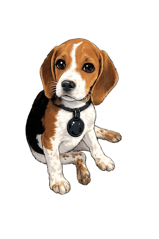

<p align="center">
  
</p>

<h1 align="center">ubu</h1>

The menubar app that keeps your Dock locked when and where you want it.

macOS moves your Dock to whichever screen you push your cursor against the bottom edge of. There's no built-in setting to disable this. **ubu** fixes that.

<h2>Install</h2>

<h3>Download</h3>

Grab the latest `.dmg` from [Releases](https://github.com/fluxscale/ubu/releases), open it, and drag `ubu.app` to Applications.

Signed and notarized by Apple — no Gatekeeper warnings.

<h3>Build from source</h3>

```bash
git clone https://github.com/fluxscale/ubu.git
cd ubu
swift build -c release
# Binary at .build/release/ubu
```

<h3>Create DMG</h3>

```bash
Distribution/DMG/create-dmg.sh 1.1.1
```

<h2>Setup</h2>

1. Launch ubu — a paw print icon appears in your menubar
2. Grant Accessibility permission when prompted (System Settings > Privacy & Security > Accessibility)
3. Done. Your Dock stays put.

ubu adds itself to your login items on first launch. Turn that off from the menubar menu and it stays off.

<h2>How it works</h2>

ubu uses two layers:

| Layer | Mechanism | Role |
|-------|-----------|------|
| **Event tap** | Watches pointer moves and drags. When the pointer rests against the Dock edge of a secondary display for 0.1s, ubu nudges it 6pt back onto that display | Stops the Dock from moving |
| **Dock watcher** | Polls which display the Dock is on (from its window-list entry). If it landed on the wrong one, ubu pushes the pointer against the primary display's Dock edge, the same gesture you'd use by hand | Puts the Dock back when it moves anyway (fast flicks, sleep/wake, display changes) |

Edges where another display continues are left unguarded, so the pointer crosses between monitors freely. Corrections are capped at three attempts, three seconds apart, and never interrupt a drag.

No private APIs, no Dock restarts.

<h2>Menubar</h2>

| Icon | State |
|------|-------|
| Filled paw | Active — Dock is anchored |
| Outline paw | Paused |
| Warning triangle | Needs Accessibility permission |

Menu options: Pause/Resume, Restart Dock (unfreezes a stuck Dock; GitHub edition only, the App Store sandbox blocks it), Start at Login, Check for Updates, Quit.

<h2>Requirements</h2>

- macOS 13.0 (Ventura) or later
- Accessibility permission
- Works with any number of displays and all Dock positions (bottom, left, right)
- The Dock is hidden in full-screen apps by macOS; ubu leaves those Spaces alone

<h2>Privacy</h2>

ubu collects nothing. See [PRIVACY.md](PRIVACY.md).

<h2>App Store edition</h2>

A sandboxed Mac App Store build ($1.99/year) is built from the same source with `-DAPP_STORE`. Setup and release steps: [Distribution/AppStore/README.md](Distribution/AppStore/README.md).

<h2>Updates</h2>

ubu checks GitHub Releases on launch and notifies you when a new version is available. You can also check manually from the menubar menu.

<h2>Architecture</h2>

```
Sources/Ubu/
├── App/
│   ├── UbuApp.swift              # Entry point, lifecycle
│   ├── AppState.swift            # Permission / subscription / pause → what to do
│   ├── StatusBarController.swift # Menubar UI
│   ├── SubscriptionManager.swift # StoreKit 2 (App Store edition only)
│   └── PermissionManager.swift   # Accessibility permission
├── Core/
│   ├── DisplayManager.swift      # Displays, Dock side, edge zones
│   ├── EventTapLayer.swift       # Layer 1: keeps the pointer off guarded edges
│   ├── DockWatcher.swift         # Layer 2: notices the Dock on the wrong display
│   ├── DockLocator.swift         # Finds the Dock's display via CGWindowList
│   ├── DockMover.swift           # Moves the Dock with a pointer push
│   └── DockMonitor.swift         # Wires the layers together
└── Utilities/
    ├── Logger.swift              # os_log wrapper
    ├── LoginItemManager.swift    # SMAppService wrapper
    └── UpdateChecker.swift       # GitHub Releases check (GitHub edition only)
```

<h2>License</h2>

[MIT](LICENSE)
